  
  
  

## Selected work

  
  
  
  

Live: [Connect](https://connect-zj9i-gamma.vercel.app/) · [Esicom Suppliers](https://esicomsuppliers-frontend.vercel.app)

## Activity

  
  

Contributions, streaks and rank come from the same public data as the GitHub profile graph. To refresh, run <code>scripts/profile_stats.py</code> then <code>scripts/graphs.py</code>.

## Stack

## Now

Studying software engineering at Moringa School and shipping client and personal projects. Most interested in automation, web apps, and fixing everyday problems with code.
